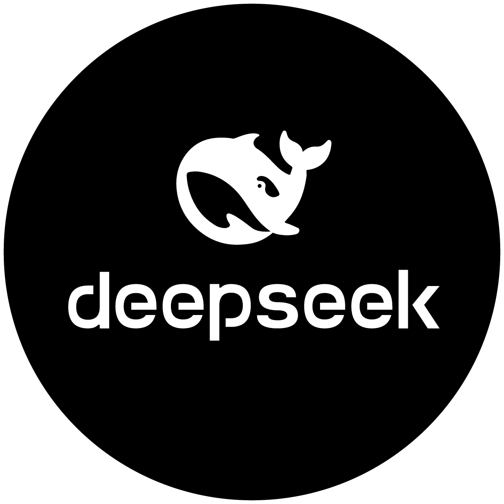

# DeepSeek for MacOS

<p align="center">
    
</p>

[](https://swift.org)
[](https://developer.apple.com/macos/)
[](https://developer.apple.com/macos/)


## 💡 Overview

A small native SwiftUI app that displays [chat.deepseek.com](https://chat.deepseek.com) in a macOS window using `WKWebView`, without an address bar.

## ✨ Features

- Your login session is kept between launches using persistent WebKit storage (`WKWebsiteDataStore.default()`).
- **DeepSeek > Sign Out** clears WebKit data associated with `deepseek.com` (shortcut **⇧⌘L**).
- DeepSeek pages stay in the app. **Links to other websites open in your default browser**.
- The navigation bar lets you go back, go forward, reload, or return to DeepSeek.
- Downloads use the macOS save dialog.
- The standard macOS shortcuts **⌘W** and **⌘Q** close the window and quit the app.

## 📦 Getting Started

To build your own copy of the app, please follow the steps below.

### 🚀 Prerequisites

- A Mac running **macOS 14 Sonoma or later**.
- **Xcode 15 or later**.
- An Internet connection to access DeepSeek.

### 🛠️ Build your own copy

1. **Clone the repository:**

    Clone the repository wherever you want.
   ```bash
   git clone https://github.com/Yohan-Janolin/MacOS_DeepSeek-Desktop.git
   ```

2. In the `DeepSeek` folder, open **`DeepSeek.xcodeproj`** in Xcode.
3. In the Xcode toolbar, select the **DeepSeek** scheme and the **My Mac** destination.
4. To build without launching the app, choose **Product > Build** or press **⌘B**.
5. To build and launch the app, choose **Product > Run** or press **⌘R**.  
    The first build may take a little while. Indexing or App Intents warnings that do not prevent Xcode from reporting **Build Succeeded** can be ignored.
6. Choose **Product > Show Build Folder in Finder**
7. Then open **Products/Debug/DeepSeek.app**.
8. Move **DeepSeek.app** to you **Application** folder.

> [!IMPORTANT]
> The provided bundle identifier is `com.example.DeepSeek`. You can change it under **Target DeepSeek > Signing & Capabilities** before signing or distributing your own build.

> [!NOTE]
> The app icon uses the official DeepSeek website favicon SVG: <https://fe-static.deepseek.com/chat/favicon.svg>.


